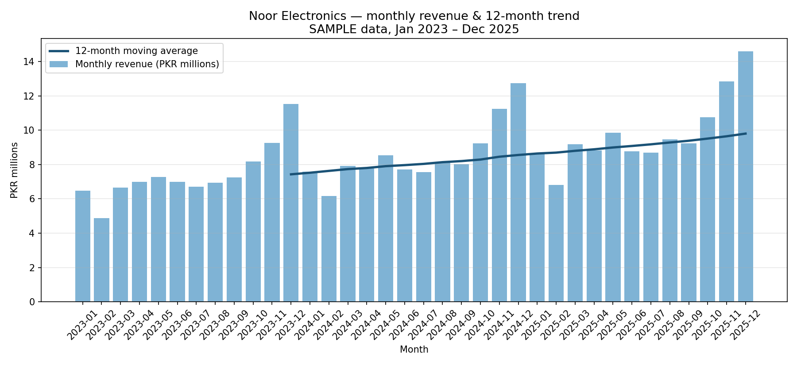

# Mini #21 — Python pandas Time Series & Resampling Pack

**Status:** built and verified locally — publish pending
(https://github.com/mhkh-stock/mini21-python-pandas-time-series).

**SAMPLE / DEMO data only.** Fictional store, fictional sales,
fictional numbers. Never claimed as real client work.

The time-series companion to Mini #19's groupby pack: the same
"Noor Electronics" shop, now as 3 years of daily sales — 1,096
days, Jan 2023 – Dec 2025. Ten pandas techniques, one per file,
each answering a question a store owner would actually ask: is
the business really growing or just seasonal, which months pay
for the year, what should next quarter look like, and does the
weekend earn its keep? Every number is recomputed independently
from the raw CSV by `src/checks.py`. This pack is the skill base
for Flagship 3 (Sales Forecasting, due 18 Dec 2026).

## Business question

"Are we actually growing — or does December just make it look that way?"

## What is inside

| File | What it does |
|---|---|
| `outputs/findings.md` | The teaching write-up: headline numbers + what each technique shows |
| `outputs/summary.json` | Every verified headline number, machine-readable |
| `outputs/monthly_revenue_trend.png` | Monthly revenue + 12-month moving average |
| `outputs/technique_01_monthly_resample.csv` | Technique 1 — daily → monthly resample (sum) |
| `outputs/technique_02_rolling_averages.csv` | Technique 2 — rolling 3-month and 12-month moving averages |
| `outputs/technique_03_mom_growth.csv` | Technique 3 — month-over-month growth |
| `outputs/technique_04_yoy_growth.csv` | Technique 4 — year-over-year growth (same month, prior year) |
| `outputs/technique_05_seasonality_index.csv` | Technique 5 — seasonality index by calendar month |
| `outputs/technique_06_trend_decomposition.csv` | Technique 6 — additive decomposition (trend + seasonal + residual) |
| `outputs/technique_07_cagr.csv` | Technique 7 — CAGR 2023 → 2025 + average monthly growth |
| `outputs/technique_08_best_worst_periods.csv` | Technique 8 — best / worst months and quarters |
| `outputs/technique_09_forecast_backtest.csv` | Technique 9 — naive + seasonal-naive forecast, backtested |
| `outputs/technique_10_weekday_weekend.csv` | Technique 10 — weekday vs weekend pattern |
| `data/raw/sales_daily_SAMPLE.csv` | The 1,096-day SAMPLE file the analysis reads |
| `data/README.md` | Data dictionary + how the story was weighted |
| `src/generate_data.py` | Regenerates the SAMPLE CSV (seed 21, deterministic) |
| `src/run_techniques.py` | The 10 pandas techniques + summary.json + findings.md |
| `src/build_chart.py` | Builds the monthly revenue trend chart |
| `src/checks.py` | Checks as code — 652 checks, all passing |
| `requirements.txt` | pandas + matplotlib (`pandas>=2.0,<3`, `matplotlib>=3.7,<4`) |

## Key numbers (real numbers, recomputed from the CSV)

| KPI | Value |
|---|---|
| Daily rows | 1,096 (Jan 2023 – Dec 2025, 36 months) |
| Total revenue | PKR 309,418,500 |
| Total units / ad spend | 25,074 units / PKR 29,546,857 |
| Average month / average day | PKR 8,594,958.33 / PKR 282,316.15 |
| Revenue 2023 → 2025 | PKR 89,142,600 → PKR 117,613,800 |
| CAGR 2023 → 2025 | 14.86% per year (2.35% a month compounded) |
| Peak month | 2025-12 — PKR 14,608,900 |
| Worst month | 2023-02 — PKR 4,887,000 |
| Best / worst quarter | 2025-Q4 PKR 38,209,900 / 2023-Q1 PKR 18,035,200 |
| Seasonality | December index 150.71, February index 69.26 |
| Backtest MAPE (Oct–Dec 2025) | Naive 26.44% / seasonal-naive 13.14% |
| Jan–Mar 2026 forecast (seasonal-naive) | PKR 8,621,000 / 6,800,900 / 9,182,000 |
| Weekend vs weekday | +15.9% (PKR 312,988 vs 270,055 a day) |
| Checks | 652 passing (`python3 src/checks.py`) |

## The 10 techniques

| # | Technique | pandas pattern | What it answers |
|---|---|---|---|
| 1 | Monthly resample | `resample("M").sum()` | What does each month actually total? |
| 2 | Rolling averages | `rolling(3)` / `rolling(12).mean()` | Where is the trend under the noise? |
| 3 | MoM growth | `pct_change()` | Which month jumped, which fell? |
| 4 | YoY growth | same month, prior year | Are we beating last year, every month? |
| 5 | Seasonality index | month-of-year mean ÷ overall mean | Which calendar months pay, which drag? |
| 6 | Trend decomposition | centred 12M MA + seasonal + residual | Trend, season, or noise — how much of each? |
| 7 | CAGR | `(end/start)^(1/2) − 1` | How fast are we really growing? |
| 8 | Best / worst periods | `sort_values` + rank | Best and worst months and quarters |
| 9 | Forecast + backtest | naive vs seasonal-naive, MAPE | What will next quarter be — and can we trust it? |
| 10 | Weekday vs weekend | `day_name()` + groupby | Does the weekend earn its keep? |

## What the pack teaches

1. **Resample before you judge.** Daily sales jump ±9% for no
   reason; the 36 monthly totals are where the story lives —
   every year bigger than the last, December always the peak.
2. **A moving average is the trend you can point at.** The
   12-month average rises in every single month of the series,
   from PKR 7,428,550 to PKR 9,801,150 — growth is a fact, not a
   feeling, and it survives the removal of every seasonal spike.
3. **MoM lies, YoY tells the truth (mostly).** The biggest MoM
   moves (+36.41% in Mar 2023, −34.09% in Jan 2024) are the
   February dip and the January comedown — calendar artefacts.
   YoY is positive in all 24 months (+10.19% to +26.29%): the
   growth is real, the monthly jumps are mostly season.
4. **Decomposition splits the blame.** Revenue = trend +
   seasonal + residual, and the components add back to the rupee
   (checked by `src/checks.py`). The trend climbs steadily, the
   seasonal repeats every year, the residual is small — this
   business is trend + season, not noise.
5. **The naive forecast is the trap.** Carrying December forward
   overstates January by a third. Seasonal-naive — "same month
   last year" — halves the backtest error (MAPE 13.14% vs
   26.44%). Any real forecasting model has to beat 13.14% to
   earn its keep.

## Verified numbers

| KPI | Value |
|---|---|
| Daily rows | 1,096 |
| Total revenue | PKR 309,418,500 |
| CAGR 2023 → 2025 | 14.86% |
| Peak month | 2025-12, PKR 14,608,900 |
| Seasonality (Dec / Feb) | 150.71 / 69.26 |
| MAPE naive / seasonal-naive | 26.44% / 13.14% |
| Weekend vs weekday gap | +15.9% |
| Checks | 652 passing (`python3 src/checks.py`) |

Verification: `python3 src/checks.py` — every headline number is
recomputed from the raw CSV with the standard library only (no
pandas) and compared against every output file: monthly sums agree
with the daily file to the rupee; rolling averages, MoM, YoY,
seasonality index, decomposition components, CAGR, best/worst
lists, forecast errors and MAPEs are all recomputed from scratch;
the decomposition components sum back to revenue; the seasonal
components sum to zero; the generator is re-run and byte-compared
for determinism (see `src/checks.py`).

## How to run it

1. Install the dependencies: `pip install -r requirements.txt`.
2. Read `outputs/findings.md` — that is the deliverable.
3. To regenerate the sample data: `python3 src/generate_data.py`.
4. To re-run the analysis: `python3 src/run_techniques.py`.
5. To rebuild the chart: `python3 src/build_chart.py`.
6. To check it: `python3 src/checks.py`.
7. To practise on your own data: replace the raw CSV (same
   columns) and re-run steps 4–6 only — do NOT re-run step 3, it
   regenerates the sample data and would overwrite your file.

## Two traps this pack teaches

- **December is not a new level.** Every December peaks and
  every January falls back by roughly a third (−34.09% in Jan
  2024, −32.31% in Jan 2025). A forecast that carries December
  forward is wrong by design — that is what the backtest proves.
- **Averages hide the calendar.** The average month is
  PKR 8,594,958, but no month actually is that: December
  averages PKR 12,953,867 and February PKR 5,953,267. One
  overall average describes a store that doesn't exist.

## Limits

- **SAMPLE data only.** The store, the sales and the "findings"
  are invented to teach the techniques. The pandas patterns are
  real.
- **One row per day, one leading category per day** — the file
  is a daily total, not an order-level file, so no basket or
  per-category time series can be built from it.
- **The forecasts are naive baselines**, not a fitted model —
  they are the benchmark a real model (the Flagship 3 forecaster)
  has to beat, not the forecast itself.
- **36 months is short for seasonality** — each calendar month
  is observed only 3 times, so the seasonality index is an
  estimate, not a law.

## Published

Publish pending: https://github.com/mhkh-stock/mini21-python-pandas-time-series
